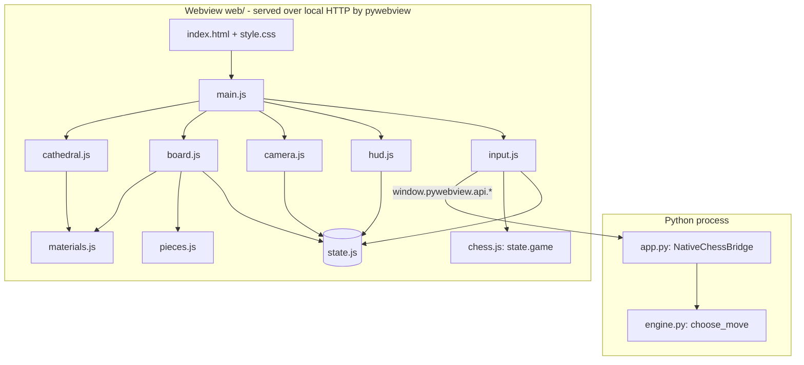

# Architecture — Wizard's Chess (Gothic Cathedral)

## Overview
A desktop 3D chess game. A Python process hosts a native window (pywebview) that renders a three.js scene; a Python engine supplies AI moves and hints over a small JS↔Python bridge. Legality in the UI is decided by chess.js; the AI uses python-chess.

## Stack
| Layer | Choice | Why |
|---|---|---|
| Shell | Python 3.10+, pywebview | Native window without Electron; `app.py` is ~60 lines |
| Rendering | three.js r128 (vendored, global `THREE`) | Procedural pieces/materials; no asset pipeline |
| UI rules | chess.js 0.10.3 (vendored, global `Chess`) | Legal moves, SAN, draw detection |
| AI | python-chess + hand-written negamax (`engine.py`) | Testable in isolation, no UI imports |
| Tests | pytest, `node --test`, Playwright visual regression | `tests/`; CI runs lint + unit tests |
| Persistence | `localStorage` settings only | Game state is not saved |

## System diagram


## Modules (all under `web/`)
| Module | Responsibility | Depends on |
|---|---|---|
| `state.js` | The single mutable state store (`state`); see `DATA_MODEL.md` | chess.js global |
| `dom.js` | One lookup table for every element id the code uses | – |
| `audio.js` | `CathedralAudio` synth, `sfx` instance | – |
| `textures.js` | Procedural HDRI and marble/obsidian canvas textures | three |
| `materials.js` | renderer/scene/camera, `cg()`/`cmat()` caches, shared materials, `SQ_SIZE` | textures |
| `cathedral.js` | Room, braziers, trim, lights (`buildCathedral`) | materials |
| `pieces.js` | One 3D mesh per piece type/colour (`buildPieceMesh`) | materials |
| `board.js` | Tiles, emissive highlights (`tintTile`), markers, `syncBoardFull`, capture shards | materials, pieces, state |
| `input.js` | Raycast picking, click-vs-orbit pointer machine, promotion dialog, `executeMoveAnimated`, `triggerAI`, hints | audio, board, dom, hud (**circular**, see debt), state, toast |
| `hud.js` | Status, ledger, captured trays, modals, undo/reset, side/quality, FEN/PGN, resign/draw, clocks, replay | audio, board, dom, input (**circular**), materials, settings, state, toast |
| `camera.js` | Orbit, presets, hotkeys | dom, hud, input, state |
| `settings.js` | Whitelisted `localStorage` persistence (try/catch everywhere) | state, audio |
| `toast.js` | Non-blocking notifications | – |
| `gpu.js` | `shortGpuName()` for the footer (unit-tested) | – |
| `main.js` | Boot, render loop, event wiring; test hooks only with `?wctest` | everything |
| `engine.py` | negamax, alpha-beta, quiescence, MVV-LVA, PSTs, history-aware repetition | python-chess |
| `app.py` | Window, bridge, bundle-safe paths | engine |

## Folder structure
```
wizards_chess/
├── app.py  engine.py  requirements.txt  package.json  wizards_chess.spec
├── README.md  HANDOFF_NOTES.md  ANTIGRAVITY_BRIEF.md  docs/
├── tests/  test_engine.py  test_packaging.py  test_*.test.mjs  visual_regression.mjs  visual_baselines/
└── web/  index.html  style.css  main.js  state.js  dom.js  audio.js  textures.js  materials.js
          cathedral.js  pieces.js  board.js  input.js  hud.js  camera.js  settings.js  toast.js  gpu.js
          vendor/{three.min.js,chess.js}
```

## Key decisions & invariants (do not undo without discussion)
- **Board parity:** a1 is a dark square (`isLight = (f + r) % 2 === 0`). Wrong parity makes queens stand on the wrong colour.
- **No coplanar surfaces:** frame top −0.02, gold trim top −0.008, tiles at 0. Coplanar layers z-fight and flicker with zoom.
- **Camera near plane 0.5**, fog density 0.008: protects depth precision.
- **Stale-result guard:** every async AI/hint result is dropped unless `gen` and `game.fen()` are unchanged. `undoMove`/`resetGame` bump `gen`.
- **Never trust the bridge:** AI moves are validated against `game.moves()` before being played.
- **Shared GPU resources:** geometry/materials from `cg()`/`cmat()` are shared. Do not mutate or `dispose()` them in place. Tile materials are per-tile clones because highlights use per-tile `emissive`.
- **Highlights are emissive**, not albedo tints.
- **Two rule engines** (chess.js, python-chess) must agree; the UI is the source of truth, Python only suggests.
- **Module loading & webview server:** ES modules (`<script type="module">`) are blocked under `file://` by WebView CORS policies. To enable clean modular ES code without requiring an extra build/bundle pipeline, `app.py` serves `web/` using pywebview's built-in HTTP server (`webview.start(http_server=True)`). The visual regression test serves `web/` over HTTP the same way (no `--allow-file-access-from-files`).
- **Test hooks are opt-in:** `window.state`, `handleSquareClick`, `camDist`, etc. exist only when the page is opened with `?wctest`. Production adds nothing to `window`.
- **Engine history needs the start position:** the bridge sends `history` (UCI moves) plus `start_fen` (null = standard start). `build_board` replays them and uses the result only if it lands exactly on the current FEN; otherwise it silently falls back to the plain position. Never replay history onto the *current* FEN.
- **FEN import is verified, not trusted:** chess.js silently drops pieces it cannot place (e.g. a second king), so `importFen` compares the loaded placement with the typed text and requires exactly one king per side.
- **Toolbar layout:** `.hud-root` has `grid-template-columns: minmax(0, 1fr)` and the toolbar wraps. Without the `minmax(0, ...)` the grid column grows to the toolbar's content width and pushes controls and the right-hand panel off-screen.

## Known structural debt
- **`input.js` ⇄ `hud.js` import each other** (and `camera.js` imports both). It works because they only call each other's functions at runtime, never at load time; any top-level use of the other module's exports would break. Fix by moving game commands (`undoMove`, `resetGame`, `triggerAI`, ...) into a `commands.js` that both import.
- Rules logic (resign/draw/clock decisions) still lives in `hud.js` next to DOM code; extracting a pure `match.js` would make it testable without DOM mocks.
