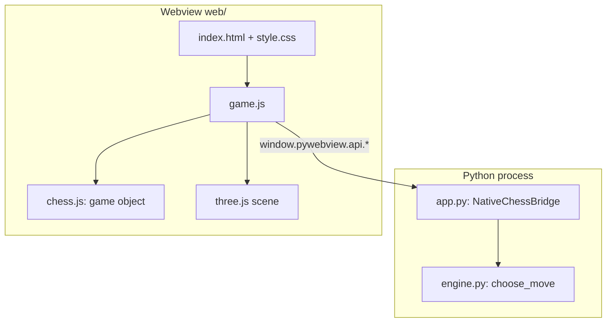

# Architecture — Wizard's Chess (Gothic Cathedral)

## Overview
A desktop 3D chess game. A Python process hosts a native window (pywebview) that renders a three.js scene; a Python engine supplies AI moves and hints over a small JS↔Python bridge. Legality in the UI is decided by chess.js; the AI uses python-chess.

## Stack
| Layer | Choice | Why |
|---|---|---|
| Shell | Python 3.10+, pywebview | Native window without Electron; `app.py` is ~60 lines |
| Rendering | three.js r128 (vendored, global `THREE`) | Procedural pieces/materials; no asset pipeline |
| UI rules | chess.js 0.10.3 (vendored, global `Chess`) | Legal moves, SAN, draw detection |
| AI | python-chess + hand-written negamax (`engine.py`) | Testable in isolation, no UI imports |
| Tests | pytest (Python), `node --test` (rules) | Already seeded in `tests/` |
| Persistence | none | Deferred (see brief) |

## System diagram


## Components (current: all inside web/game.js unless noted)
| Section (approx. lines) | Responsibility | Reads / writes shared state |
|---|---|---|
| Caches `cg()`, `cmat()` (1–20) | Shared geometry/material cache | none |
| `CathedralAudio` / `sfx` (21–120) | Synth sound effects | none (`sfx.muted`) |
| HDRI + stone textures (122–260) | Procedural textures/env map | none |
| `buildCathedral` (269–400) | Room, braziers, trim, lights | `sunLight`, `brazierLights`, `flameCones` |
| `buildPieceMesh` (465–740) | One 3D mesh per piece type/colour | none |
| Board + markers (743–935) | Tiles, highlights, `rebuildTacticalMarkers`, `syncBoardFull` | `game`, `selectedSq`, `validMoves`, `lastMove`, `hintMove`, `pieceMeshes`, `squareMeshes` |
| `spawnShatter` (936) | Capture particles | `shards` |
| Picking + pointer input (968–1110) | Raycast, hover, click-vs-orbit state machine | `pointerState`, `validMoves`, `hoveredSq`, `isDraggingCam` |
| Move flow (1110–1210) | `executeMoveAnimated`, `triggerAI`, `showTacticalHint` | `game`, `gen`, `aiPendingGen`, `isAnimating`, `activeAnim` |
| `updateHUD` (1211–1290) | Status, ledger, captured pieces, end modal | `game` (read-only) |
| Camera, hotkeys, commands (1294–1415) | Orbit, presets, undo/reset/side/quality | many |
| `animate` loop (1425–end) | Per-frame update, FPS | everything |
| `engine.py` | Search: negamax, alpha-beta, quiescence, MVV-LVA, PSTs | none (pure) |
| `app.py` | Window + bridge, bundle-safe paths | none |

## Folder structure (current)
```
wizards_chess/
├── ANTIGRAVITY_BRIEF.md
├── app.py            engine.py        requirements.txt   package.json
├── docs/             tests/ (test_engine.py, test_rules.test.mjs)
└── web/ index.html  style.css  game.js  vendor/{three.min.js,chess.js}
```

## Key decisions & invariants (do not undo without discussion)
- **Board parity:** a1 is a dark square (`isLight = (f + r) % 2 === 0`). Wrong parity makes queens stand on the wrong colour.
- **No coplanar surfaces:** frame top −0.02, gold trim top −0.008, tiles at 0. Coplanar layers z-fight and flicker with zoom.
- **Camera near plane 0.5**, fog density 0.008: protects depth precision.
- **Stale-result guard:** every async AI/hint result is dropped unless `gen` and `game.fen()` are unchanged. `undoMove`/`resetGame` bump `gen`.
- **Never trust the bridge:** AI moves are validated against `game.moves()` before being played.
- **Shared GPU resources:** geometry/materials from `cg()`/`cmat()` are shared. Do not mutate or `dispose()` them in place. Tile materials are per-tile clones because highlights use per-tile `emissive`.
- **Highlights are emissive**, not albedo tints.
- **Two rule engines** (chess.js, python-chess) must agree; the UI is the source of truth, Python only suggests.
